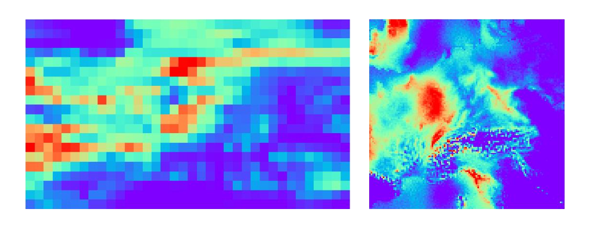

## Introduction

Global climate models (GCMs) are huge physics simulations of the atmosphere, oceans, land, and ice, and they are our main tool for asking what the climate will look like in 2050 or 2100. They are also coarse. A typical GCM grid cell is about 100 km wide, so a whole Alpine valley, a coastline, or a city sits inside a single pixel. That is fine for global mean temperature. It is not enough for a hydrologist planning a reservoir, or a city planning for heavy rainfall, because precipitation and temperature are shaped by terrain and other features far smaller than the grid. On top of that, GCM outputs carry systematic biases relative to observations [@collins2013long], and their coarse resolution makes them unsuitable for local climate analysis on their own [@lowres_incapable_local].

Turning coarse climate model output into high-resolution regional information is called **downscaling**. There are two broad routes:

- **Dynamical downscaling** runs a *regional climate model* (RCM) over a limited area at roughly 10 km resolution, using the GCM fields as boundary conditions. This is physically grounded but very expensive [@gutowski2020ongoingneed], and the RCM inherits whatever biases the driving GCM has [@liang2008regional].
- **Statistical downscaling** learns an empirical map from coarse fields to fine fields. Once trained, it costs almost nothing to run. Classical tools like random forests have long been solid baselines, and CNNs and U-Nets have pushed accuracy further [@cnnrodrigues2018; @lin2023deep].

Most statistical downscaling models are *deterministic*: one coarse input, one high-resolution output. But the mapping is not one-to-one. Many fine-scale weather patterns are consistent with the same coarse field, and that spread is exactly what matters for extremes. A deterministic model trained with squared error learns the conditional mean, which shows up as smooth, blurry fields that systematically underestimate local variability. Generative models, such as GANs and diffusion models, can instead sample from the full conditional distribution [@ling_diffusion_2024].

For my semester paper at the Seminar for Statistics at ETH Zurich, Gianfranco Basile and I (equal contribution), supervised by Maybritt Schillinger and Nicolai Meinshausen, looked at a question that matters a lot in practice but rarely gets tested directly: **if you train a generative downscaling model on some climate models, does it still work on a climate model it has never seen?** Climate projections are built from ensembles of many GCMs, and a downscaler that only works for the GCMs it was trained on is of limited use. We also asked whether the mapping holds up in time, from the training period out to the end of the 21st century.

Our main findings:

1. Both generative methods beat a deterministic baseline by a wide margin in **energy score**, a proper scoring rule for multivariate distributions, while matching it in **mean squared error**.
2. The learned mappings **transfer surprisingly well to an unseen GCM** and to the 2090s.
3. A simple **stochastic MLP trained with the energy score** matches or beats a diffusion model, at a fraction of the compute.

The full paper is available as a [<i class="bi bi-file-earmark-pdf"></i> PDF](../../research/JHSchlegel_Semester-Paper.pdf).

## Problem Setup

Let $\mathcal{X} \subseteq \mathbb{R}^{c_\text{in} \times 36 \times 20}$ be the space of coarse GCM inputs and $\mathcal{Y} \subseteq \mathbb{R}^{c_\text{out} \times 128 \times 128}$ the space of high-resolution RCM fields. The input has $c_\text{in} = 2$ channels, the target variable plus a pressure variable. The output has $c_\text{out} = 1$ channel, either **temperature** or **precipitation**. We write $\mathbf{X}$ and $\mathbf{Y}$ for the random coarse and fine fields, and given $N$ paired samples $\{(\mathbf{x}_i, \mathbf{y}_i)\}_{i=1}^N$ we want to learn the **conditional distribution**

$$
\mathbb{P}(\mathbf{Y} \mid \mathbf{X}),
$$

and not just its mean $\mathbb{E}[\mathbf{Y} \mid \mathbf{X}]$. That is the key difference from classical regression-based downscaling.

It is also useful to define an intermediate object: a **coarsened regional field** $\mathbf{Z}$, obtained by average-pooling $\mathbf{Y}$ with a $16 \times 16$ kernel. This gives an $8 \times 8$ summary of the high-resolution field on the regional domain. $\mathbf{Z}$ does not come from the GCM. It is an aggregate of the RCM output, so it already contains the regional model's view of large-scale structure. As we will see, splitting the problem into "predict $\mathbf{Z}$ from $\mathbf{X}$" and "predict $\mathbf{Y}$ from $\mathbf{Z}$" turns out to be a good idea.

Finally, we add a sinusoidal encoding of the date to each input $\mathbf{x}_i$, to capture seasonality, as well as a one-hot encoding of the GCM–RCM pair.

### Why Squared Error Is Not Enough: The Energy Score

To train and compare generative models we need a loss that rewards getting the whole distribution right, not just the mean. We use the **energy score** [@Gneiting01032007], a multivariate generalization of the CRPS [@Matheson76; @Szekely2003]. I covered it in more depth in my [post on proper scoring rules](../30-01-2026_proper-scoring-rules/index.qmd). Written as a loss (lower is better), for a predictive distribution $P$ and an observed field $\mathbf{y}$:

$$
\mathcal{L}_\text{energy}(P, \mathbf{y}) = \mathbb{E}_{P}\,\|\mathbf{Y} - \mathbf{y}\| - \frac{1}{2}\, \mathbb{E}_{P}\,\|\mathbf{Y} - \mathbf{Y}'\|,
$$

where $\mathbf{Y}, \mathbf{Y}' \sim P$ are independent and $\|\cdot\|$ is the Euclidean norm over all pixels. The two terms pull in opposite directions:

- The **accuracy term** $\mathbb{E}\|\mathbf{Y} - \mathbf{y}\|$ pulls samples toward the observation.
- The **spread term** $-\tfrac{1}{2}\mathbb{E}\|\mathbf{Y} - \mathbf{Y}'\|$ rewards samples that differ from each other.

The energy score is **strictly proper**: its expected value is minimized only when $P$ equals the true conditional distribution. A model cannot game it by collapsing to a point prediction (the spread term is then zero, and the accuracy term is generally larger than it would be under the right distribution), and it cannot game it by adding arbitrary noise (the accuracy term grows faster than the spread term rewards it). In practice we draw $m$ samples $\hat{\mathbf{y}}_1, \ldots, \hat{\mathbf{y}}_m$ per input and use the unbiased estimator

$$
\widehat{\mathcal{L}}_\text{energy} = \frac{1}{m}\sum_{j=1}^m \|\hat{\mathbf{y}}_j - \mathbf{y}\| - \frac{1}{2m(m-1)}\sum_{j \neq k} \|\hat{\mathbf{y}}_j - \hat{\mathbf{y}}_k\|.
$$

This estimator is differentiable in the samples, so if the samples come from a neural network driven by noise we can backpropagate through it directly. That is the core idea behind the first model.

## Model 1: Coarse-from-Super

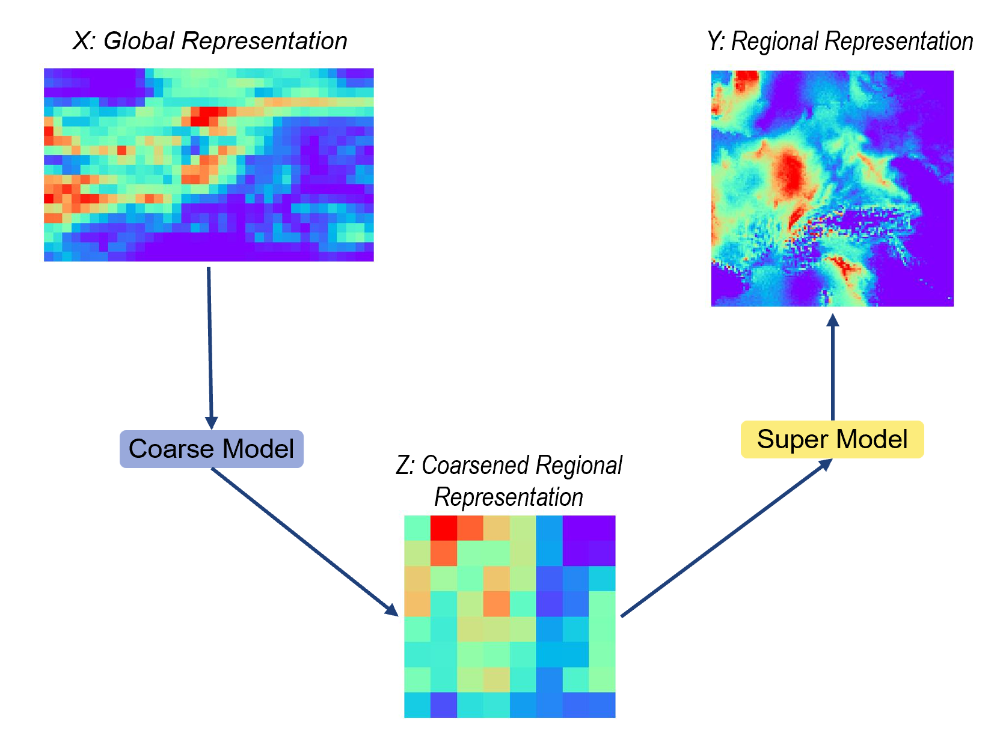{width=85%}

The Coarse-from-Super (CfS) model splits downscaling into two stochastic sub-problems, each handled by a residual MLP with **noise injection**: in every residual block, a vector $\boldsymbol{\epsilon} \sim \mathcal{N}(0, \mathbf{I})$ is concatenated with the hidden features. Because noise enters at every stage, the network is an implicit generative model. Feed it the same input twice and you get two different samples. This is the same recipe as *engression* [@shen2024engression]: a noise-driven neural network trained only with the energy score, with no likelihood, no adversary, and no diffusion process.

1. **Super model** $f_\text{super}(\mathbf{Z}, \boldsymbol{\eta})$: maps the $8 \times 8$ coarsened regional field to the full $128 \times 128$ field. Six layers (three residual blocks), hidden dimension 500, and a 100-dimensional noise vector.
2. **Coarse model** $f_\text{coarse}(\mathbf{X}, \boldsymbol{\epsilon})$: maps the flattened GCM input to the coarsened regional field. Six layers, hidden dimension 64, and a 10-dimensional noise vector.

Training happens in two stages. First, the super model is trained on pairs $(\mathbf{z}_i, \mathbf{y}_i)$ with the energy loss, and then **frozen**. Second, the coarse model is trained end-to-end through the frozen super model:

$$
\hat{\mathbf{Z}} = f_\text{coarse}(\mathbf{X}, \boldsymbol{\epsilon}), \qquad \hat{\mathbf{Y}} = f_\text{super}(\hat{\mathbf{Z}}, \boldsymbol{\eta}),
$$

$$
\mathcal{L}(\mathbf{X}, \mathbf{Z}, \mathbf{Y}) = \lambda_\text{coarse}\, \mathcal{L}_\text{energy}(\mathbf{Z}, \hat{\mathbf{Z}}) + (1 - \lambda_\text{coarse})\, \mathcal{L}_\text{energy}(\mathbf{Y}, \hat{\mathbf{Y}}),
$$

with $\lambda_\text{coarse} = 0.9$. The first term asks the coarse model to get the large-scale regional pattern right. The second checks that, once the super model fills in the details, the full field is also well calibrated.

Why bother with the intermediate step? The jump from a GCM field to a $128 \times 128$ RCM field mixes two different problems. One is **translation**: the GCM and the RCM do not agree on where it rains, so large-scale patterns have to be corrected. The other is **super-resolution**: given the large-scale regional pattern, fill in the orographic and convective detail. Separating them lets each sub-model focus on one job. The super model, in particular, never sees a GCM. It only learns RCM-internal structure, which is plausibly the part that transfers across GCMs.

Both stages use AdamW [@loshchilov2019adamw] with learning rate $3 \times 10^{-4}$, an exponential decay of 0.99 per epoch, a batch size of 512, and 300 epochs. Inputs and outputs are square-root transformed before normalization, which tames the heavy right tail of precipitation.

## Model 2: Corrector Diffusion (CorrDiff)

The second approach follows CorrDiff, introduced by @corrdiff2024 for km-scale weather downscaling. Their observation was that a plain conditional diffusion model trained to sample $\mathbf{Y} \mid \mathbf{X}$ directly converges slowly and gives poor samples, because it has to learn both the large-scale mean and the fine-scale variability from scratch. CorrDiff splits the field into a deterministic part and a stochastic part:

$$
\mathbf{Y} = \underbrace{\mathbb{E}[\mathbf{Y} \mid \mathbf{X}]}_{\text{regression } \boldsymbol{\mu}(\mathbf{X})} + \underbrace{\mathbf{R}}_{\text{stochastic residual}}, \qquad \mathbf{R} := \mathbf{Y} - \boldsymbol{\mu}(\mathbf{X}).
$$

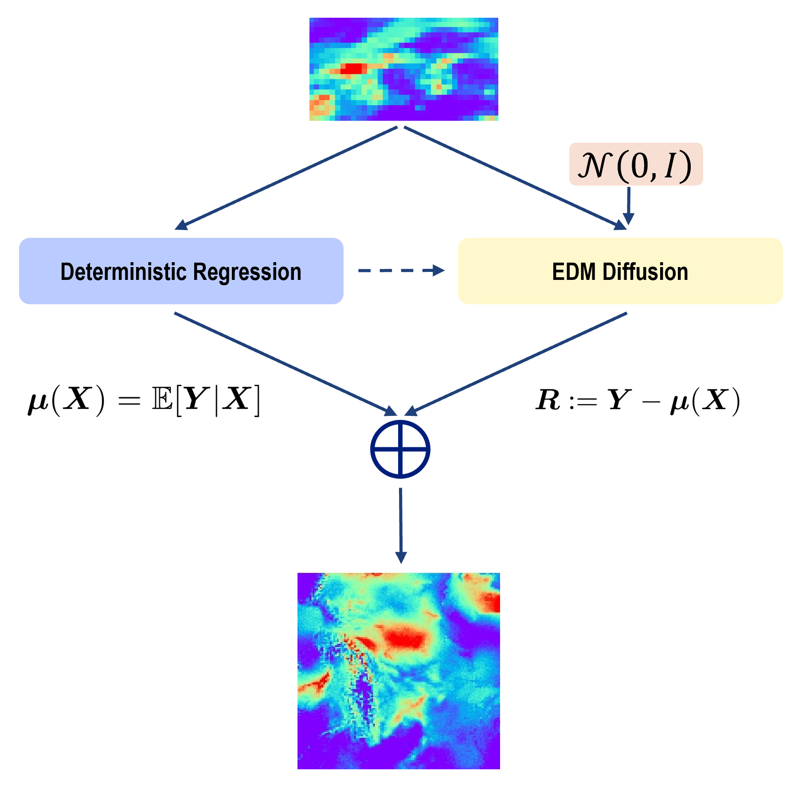{width=70%}

### Step 1: Deterministic Regression

The original CorrDiff uses a large U-Net for the mean. Given our compute budget, we used a deterministic MLP $f_\theta$ with the same architecture as the CfS super model, but without noise injection, trained with plain squared error:

$$
\mathcal{L}_\text{reg}(\theta) = \mathbb{E}_{(\mathbf{x}, \mathbf{y})}\big[\|\mathbf{y} - f_\theta(\mathbf{x})\|_2^2\big].
$$

Its minimizer is the conditional mean, so after training we can compute residuals $\hat{\mathbf{r}}_i = \mathbf{y}_i - f_\theta(\mathbf{x}_i)$. These residuals are roughly zero-mean, much smaller in scale than the raw fields, and contain almost no large-scale structure. That makes them a far easier target for a diffusion model. This regressor, on its own, is also our **deterministic baseline**.

### Step 2: An Elucidated Diffusion Model for the Residual

The residual distribution $\mathbb{P}(\mathbf{R} \mid \mathbf{X})$ is modeled with an Elucidated Diffusion Model (EDM) [@karras2022edm]. (If SDE-based diffusion is new to you, my [introduction to SDEs](../03-04-2025_intro_to_sde/index.html) covers the basics.) The forward process gradually corrupts a residual with Gaussian noise,

$$
d\mathbf{r} = \sqrt{2\dot\sigma(t)\sigma(t)}\, d\mathbf{W}_t,
$$

where $\sigma(t)$ is the noise schedule (EDM uses $\sigma(t) = t$). Sampling runs the corresponding reverse-time SDE

$$
d\mathbf{r} = -2\dot\sigma(t)\sigma(t)\, \nabla_{\mathbf{r}} \log p(\mathbf{r} \mid \sigma(t), \mathbf{c})\, dt + \sqrt{2\dot\sigma(t)\sigma(t)}\, d\bar{\mathbf{W}}_t,
$$

which needs the **score** $\nabla_{\mathbf{r}} \log p(\mathbf{r} \mid \sigma, \mathbf{c})$. The conditioning $\mathbf{c}$ consists of the nearest-neighbor-upsampled GCM input $\mathbf{x}$ and a learned embedding $\psi(t_\text{target})$ of the date. The score is not available in closed form, but it can be written in terms of an optimal denoiser $D$:

$$
\nabla_{\mathbf{r}} \log p(\mathbf{r} \mid \sigma, \mathbf{c}) = \frac{D(\mathbf{r}; \sigma, \mathbf{c}) - \mathbf{r}}{\sigma^2}.
$$

So we only need to train a network $D_\phi$ to remove noise, using the standard denoising score matching objective, averaged over noise levels:

$$
\mathcal{L}_\text{diff}(\phi) = \mathbb{E}_{\mathbf{r}}\, \mathbb{E}_{\sigma \sim p_\sigma}\, \mathbb{E}_{\boldsymbol{\eta} \sim \mathcal{N}(0, \sigma^2 \mathbf{I})} \big[\|D_\phi(\mathbf{r} + \boldsymbol{\eta}; \sigma, \mathbf{x}, \psi(t_\text{target})) - \mathbf{r}\|_2^2\big].
$$

Conditioning on $\mathbf{x}$ is done by concatenating it with the noisy residual along the channel dimension. For $D_\phi$ we used a reduced DDPM++ U-Net [@song2021scorebasedgenerativemodelingstochastic]: base width 64 with channel multipliers $[1, 2, 2, 2]$ (resolutions $128 \to 64 \to 32 \to 16$), four residual blocks per level, self-attention at $16 \times 16$, and dropout of 0.1. It was trained for 30 epochs with AdamW, a 10-epoch linear warm-up followed by cosine annealing, and gradient clipping at norm 10.

### Sampling

At test time, a high-resolution sample is the regression mean plus a sampled residual. Since $f_\theta$ only has to be evaluated once, drawing an ensemble of $M$ members is cheap on the regression side:

$$
\mathbf{y}_{\text{new}, j} = f_\theta(\mathbf{x}_\text{new}) + \tilde{\mathbf{r}}_{\text{new}, j}, \qquad j = 1, \ldots, M.
$$

Residuals are generated with EDM's second-order Heun sampler using $N = 40$ steps, which we found sufficient for good precipitation samples. Below is a compact sketch of the sampler. We fixed $S_\text{churn} = 0$ because we did not have the compute for a grid search. Note what that implies: with no churn, the noise inflation step does nothing, and the sampler reduces to a **deterministic ODE solver** for the probability-flow ODE. All of the randomness in a CorrDiff sample then comes from the initial draw $\mathbf{r}_0 \sim \mathcal{N}(0, t_0^2 \mathbf{I})$.

```python
import torch


@torch.no_grad()
def corrdiff_sample(denoiser, x_up, date_emb, n_steps=40,
                    sigma_min=0.002, sigma_max=80.0, rho=7.0, s_churn=0.0):
    """EDM stochastic sampler (Karras et al., Alg. 2) for the CorrDiff residual.

    denoiser(r, sigma, x_up, date_emb) -> D_phi, the denoised residual.
    sigma_min / sigma_max / rho are EDM's default discretization settings.
    """
    # Noise levels t_0 > t_1 > ... > t_{N-1} > t_N = 0 (EDM's rho-schedule)
    i = torch.arange(n_steps)
    t = (sigma_max ** (1 / rho)
         + i / (n_steps - 1) * (sigma_min ** (1 / rho) - sigma_max ** (1 / rho))) ** rho
    t = torch.cat([t, torch.zeros(1)])

    r = torch.randn_like(x_up[:, :1]) * t[0]  # r_0 ~ N(0, t_0^2 I)
    for k in range(n_steps):
        # "Churn": temporarily raise the noise level (no-op when s_churn = 0)
        gamma = min(s_churn / n_steps, 2 ** 0.5 - 1)
        t_hat = t[k] * (1 + gamma)
        r_hat = r + (t_hat ** 2 - t[k] ** 2).sqrt() * torch.randn_like(r)

        # Euler step along the probability-flow ODE
        d = (r_hat - denoiser(r_hat, t_hat, x_up, date_emb)) / t_hat
        r = r_hat + (t[k + 1] - t_hat) * d

        # Heun (second-order) correction, skipped at the final step
        if t[k + 1] > 0:
            d_prime = (r - denoiser(r, t[k + 1], x_up, date_emb)) / t[k + 1]
            r = r_hat + (t[k + 1] - t_hat) * 0.5 * (d + d_prime)
    return r


# High-resolution sample = regression mean + diffusion residual
# y = f_theta(x) + corrdiff_sample(D_phi, upsample(x), psi(t_target))
```

Each sample therefore costs $2N - 1 = 79$ U-Net evaluations at full resolution. The CfS model needs two MLP forward passes. Keep that difference in mind when we get to the results.

## Experimental Design

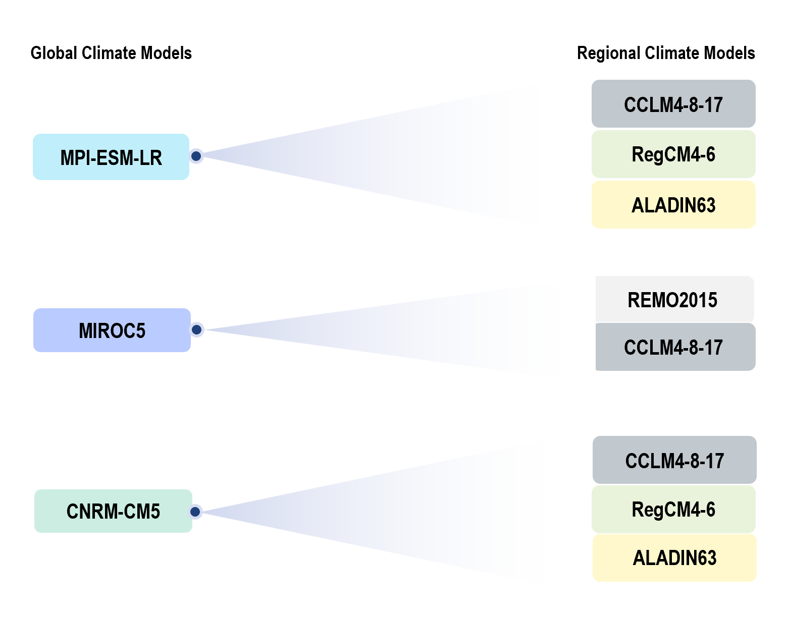{width=75%}

We use three GCMs, **MPI-ESM-LR**, **MIROC5**, and **CNRM-CM5**, each run at about 100 km resolution [@kaltenborn2023]. Each one drives a subset of four RCMs: **CCLM4-8-17**, **ALADIN63**, **RegCM4-6**, and **REMO2015**. The RCM output is treated as the high-resolution "ground truth". So the models learn to reproduce what a regional climate model would have produced. They are not trained or evaluated against station observations.

### Cross-GCM Extrapolation

The core experiment is **leave-one-GCM-out**:

- **Extrapolation (unseen GCM):** train on all GCM–RCM pairs from *two* GCMs, and test on every RCM driven by the held-out third GCM.
- **Interpolation baseline (known GCM):** train on all pairs from a *single* GCM, and test on the same GCM.

Putting the two side by side shows how much we lose by meeting a new GCM at test time. Because some RCMs are much harder to emulate than others, all results are broken down by test RCM.

### Temporal Extrapolation

The data span 1971–2099 under a climate change scenario. Two decades are held out entirely:

- **Test interpolation:** 2030–2039, inside the training range.
- **Test extrapolation:** 2090–2099, past the end of the training data (which uses 1971–2029 and 2040–2089).

The 2090s are the harder test, since the late-century climate is warmer than anything in training. For comparability, every experiment uses 60,000 training and 10,000 validation samples, drawn at random from the training years. For CfS and the deterministic MLP we keep the checkpoint with the best validation score. CorrDiff reuses the selected deterministic regressor and trains the EDM for a fixed 30 epochs.

## Results

In all plots below, columns are the two test periods and rows are the test RCMs. **Colors** mark the test GCM, **triangles** mean the test GCM was seen during training (interpolation baseline), **circles** mean it was held out (extrapolation), and dashed lines connect results from the same training configuration across the three methods.

### Precipitation

Precipitation is the hard case. It is intermittent, heavy-tailed, and strongly shaped by terrain and convection, which are exactly the small-scale processes a 100 km grid cannot resolve.

<table>
<tr>
<td style="width:50%; padding:4px;">
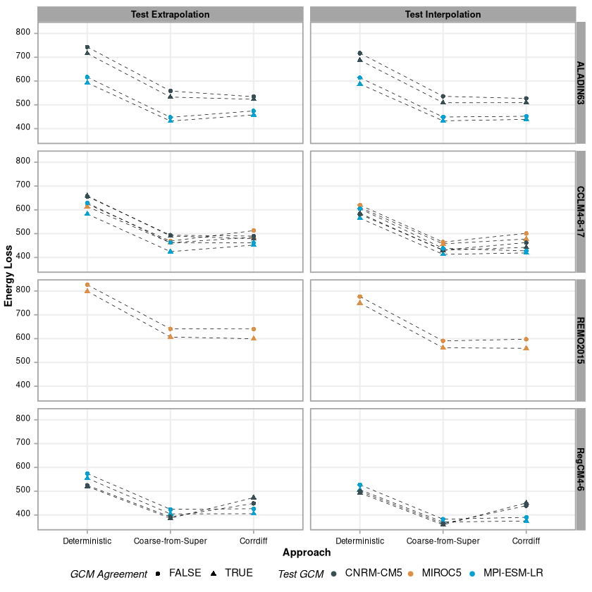
<em>(a) Energy loss</em>
</td>
<td style="width:50%; padding:4px;">
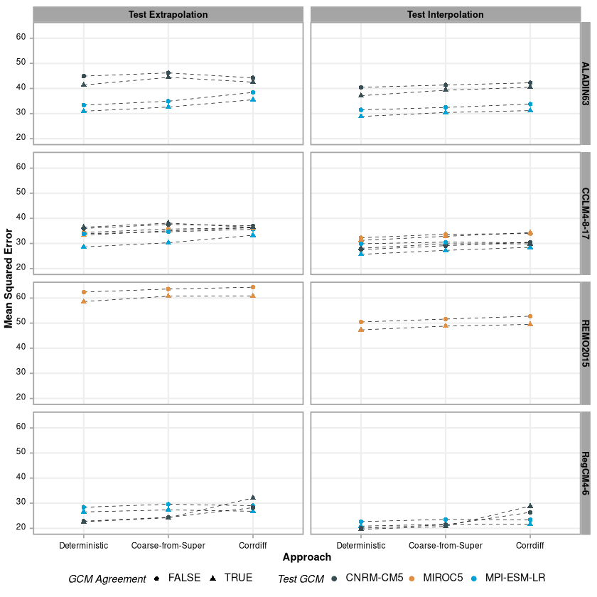
<em>(b) Mean squared error</em>
</td>
</tr>
</table>

The energy loss panel tells a consistent story. **Both generative models beat the deterministic baseline in every single configuration**: every RCM, both test periods, seen and unseen GCMs. The gap is large, typically a 20–30% reduction (e.g. from about 740 to about 550 for ALADIN63 driven by CNRM-CM5 in the 2090s). The deterministic model's fields are too smooth. It predicts the conditional mean, has no spread, and gets penalized for missing the variability of real precipitation.

Between the two generative models, **Coarse-from-Super performs on par with or better than CorrDiff** in most configurations, most clearly for RegCM4-6, while being much cheaper to train and sample from. To be fair, CfS has a home advantage here: it is trained directly on the energy score, the same metric used for evaluation, whereas CorrDiff is trained with denoising score matching.

The MSE panel looks completely different: **all three methods are nearly tied**. The deterministic model is often marginally best. That is expected, since it was trained with squared error and its target, the conditional mean, is by construction the MSE-optimal point prediction. The important point is that the generative models get their large distributional gains **without paying for them in squared error**.

Three more observations:

- **REMO2015 is by far the hardest RCM** in both metrics. It is only driven by MIROC5 in our data, so it has the least training data and the least diversity.
- **Seen GCMs (triangles) are generally a little better than unseen ones (circles)**, but the gap is small compared to the gap between methods. Going from a known to an unknown GCM costs far less than going from a generative to a deterministic model.
- **The 2090s look almost exactly like the 2030s.** Metrics on the far-future test decade are close to those on the near-future decade, so none of the methods break down as the climate shifts.

### Temperature

Temperature is smoother in space and time, which makes it an easier downscaling target. Due to compute limits, we only trained the deterministic and Coarse-from-Super models for temperature.

<table>
<tr>
<td style="width:50%; padding:4px;">
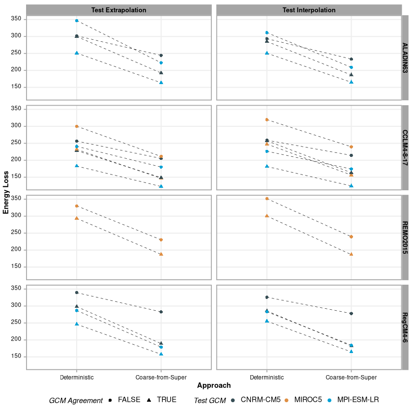
<em>(a) Energy loss</em>
</td>
<td style="width:50%; padding:4px;">
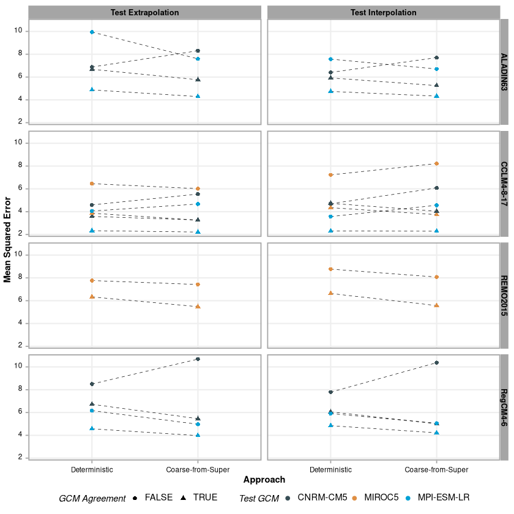
<em>(b) Mean squared error</em>
</td>
</tr>
</table>

The pattern repeats. Coarse-from-Super lowers the energy loss by roughly 20–35% in every configuration, while MSE stays comparable, with the deterministic model sometimes slightly ahead.

::: {.callout-note collapse="true"}
## Relative performance against the single-GCM baseline

We also normalized each model's metrics by those of a model trained and tested on the same GCM. A value of $0.2$ means 20% worse than that in-GCM baseline, and negative values mean better.

<table>
<tr>
<td style="width:50%; padding:4px;">
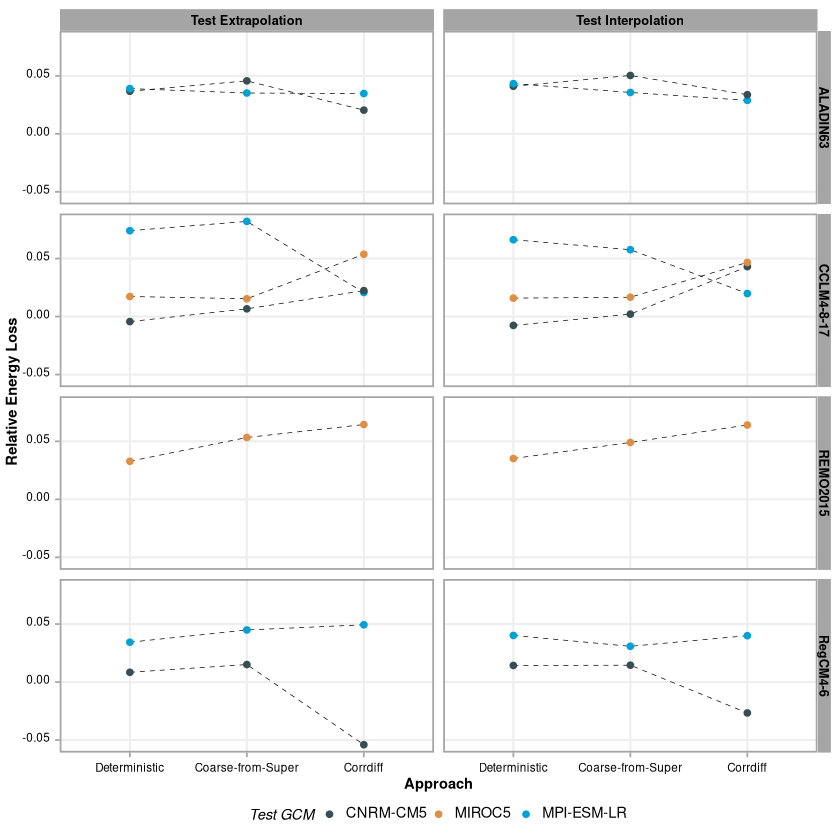
<em>Precipitation: relative energy loss</em>
</td>
<td style="width:50%; padding:4px;">
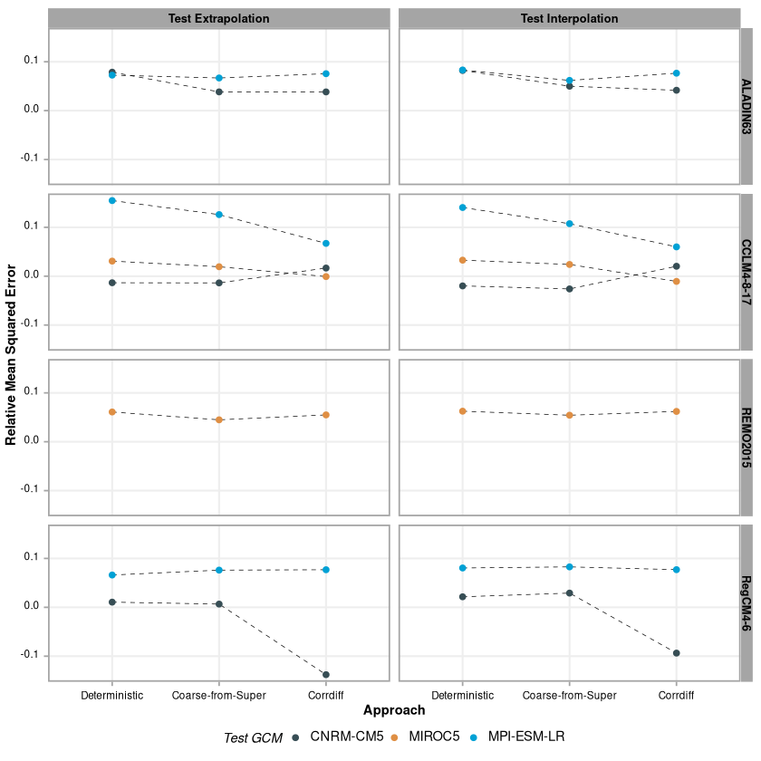
<em>Precipitation: relative MSE</em>
</td>
</tr>
<tr>
<td style="width:50%; padding:4px;">
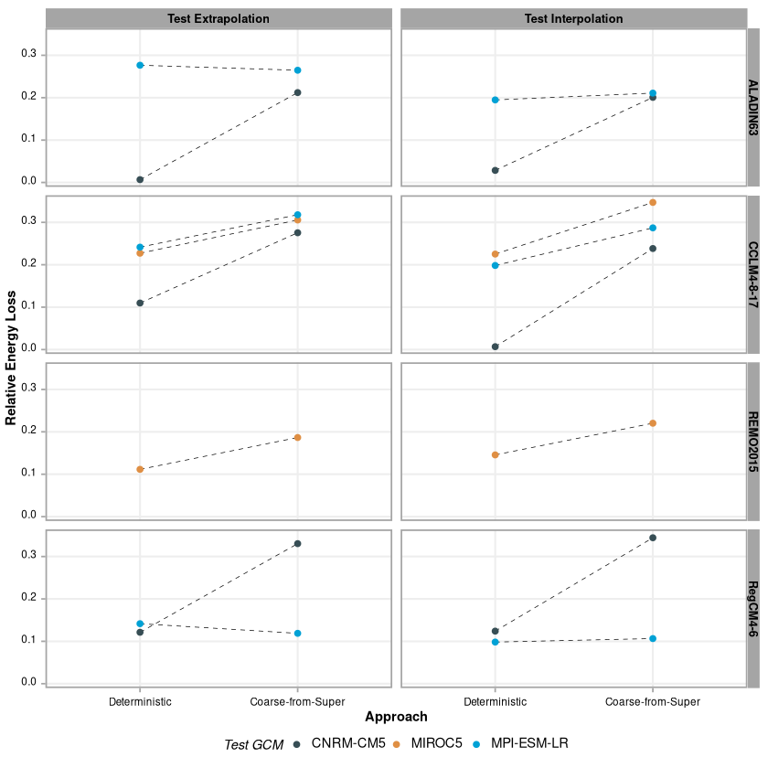
<em>Temperature: relative energy loss</em>
</td>
<td style="width:50%; padding:4px;">
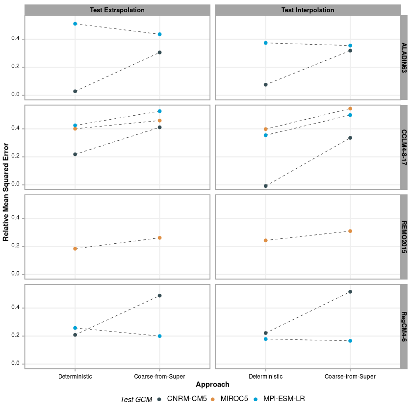
<em>Temperature: relative MSE</em>
</td>
</tr>
</table>

For precipitation, the relative numbers move around a lot between GCM–RCM pairs, and no method wins consistently. Which pair you test on matters more than which model you use. For temperature, Coarse-from-Super tends to lose a bit more, relative to its own in-GCM baseline, than the deterministic model does. Its *absolute* energy loss is still much lower. Because temperature is easy, an in-GCM generative model is already very good, so there is more room to fall when the GCM changes. The general lesson is that relative comparisons depend heavily on the choice of baseline, and an absolute gain in distributional accuracy does not always show up as a uniform relative gain.
:::

## Reflections

I took away three things from this project.

**Use a proper scoring rule, or you won't see the difference.** Had we only reported MSE, we would have concluded that the three methods are interchangeable and the deterministic one is cheapest. The energy score shows that the generative models capture a large part of the problem the deterministic model ignores entirely: the variability of the regional field given the coarse input. For a downscaler meant to inform decisions about extremes, that variability is the point.

**The learned mappings transfer better than we expected.** We went in thinking that cross-GCM extrapolation would be the weak spot, since every GCM has its own biases and the RCMs inherit them. Instead, the loss from moving to an unseen GCM was modest and consistent, and performance in the 2090s closely tracked the 2030s. For using statistical downscaling on large multi-model ensembles, this is encouraging.

**Simple stochastic models are underrated.** A pair of noise-injected MLPs trained with the energy score matched a diffusion model that needs 79 U-Net evaluations per sample. That cuts against the common assumption that serious generative downscaling needs a heavy architecture. Our stripped-down CorrDiff, a small MLP for the mean plus a modest U-Net, also produced good samples. So the two-step "mean plus residual" decomposition seems to be doing much of the work, independently of how big the networks are.

The study has clear limitations. We evaluated against RCM output, not observations, so "accuracy" here means fidelity to a regional climate model. We did not vary the size of the training subsample (fixed at 60,000), did not tune EDM hyperparameters such as $S_\text{churn}$, and only ran CorrDiff on precipitation. Natural next steps would be to swap the MLP regressor in CorrDiff for a U-Net, as in the original paper, or for a climate foundation model like Prithvi WxC [@schmude2024prithviwxcfoundationmodel], and to test **spatial** transfer to regions outside the training domain, in addition to the GCM and temporal transfer studied here.

Still, the main result is fairly robust. Two-step generative models produce realistic, well-calibrated high-resolution climate fields, and they keep doing so on climate models and decades they were never trained on.
