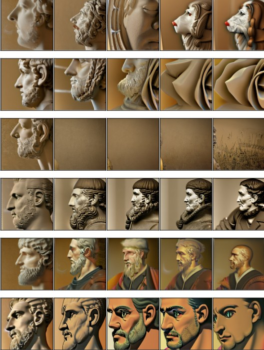{width=60% fig-align="center"}

## Introduction

Type "a portrait of a stoic Roman emperor, profile view" into Stable Diffusion and a few seconds later you get exactly that. What happens in between is much less clear. Somewhere along the 25 or so denoising steps, a block of Gaussian noise is pushed towards an image that has a subject, a composition, a style, and fine texture. When are those decisions made? Which internal components make them? And how do these components talk to each other across time?

These are the questions of *mechanistic interpretability*: rather than studying input-output behaviour, we try to reverse-engineer a network's internal representations into concepts a human can understand [@bereska2024mechanisticinterpretabilityaisafety]. For large language models this programme has made real progress over the last few years, mostly thanks to **sparse autoencoders (SAEs)** [@bricken2023monosemanticity; @templeton2024scaling; @cunningham2023sparseautoencodershighlyinterpretable] and, more recently, **sparse feature circuits** [@marks2025sparsefeaturecircuitsdiscovering]. Diffusion models are a harder target. They are multimodal, high-dimensional, and, most importantly, *iterative*: the same U-Net is applied over and over, and anything it computes at one step becomes part of the input at the next.

My master's thesis at ETH Zurich, supervised by Prof. Julia Vogt and advised by Moritz Vandenhirtz and Alice Bizeul, tries to take this programme to Stable Diffusion v2.1 [@rombach2022highresolutionimagesynthesislatent]. In short, I:

1. trained SAEs on two cross-attention blocks of SD v2.1 and used them to show, through **time-stratified interventions**, that the generative process follows a clear temporal hierarchy: composition and style early, refinement and blending in the middle, texture at the end;
2. found that features learned on $512\times512$ generations **transfer to $768\times768$** without any retraining, both for reconstruction and for steering;
3. built a **temporal circuit discovery framework** for diffusion models, combining integrated-gradient attribution with a small diagnostic probe that plays the role of the "logit difference" from language-model interpretability;
4. checked the discovered "cat vs. bird" circuit with a **bidirectional activation patching** method that works for non-distilled models with classifier-free guidance.

The full code for this project is available on [<i class="bi bi-github"></i> GitHub](https://github.com/JHSchlegel/mechinterp-diffusion), and the thesis itself is on my [research page](../../research.qmd).

## Background

### Latent Diffusion in Two Paragraphs

A diffusion model learns to undo a gradual noising process. The forward process turns a data point $\boldsymbol{x}_0$ into noise via
$$
\boldsymbol{x}_t = \sqrt{\bar{\alpha}_t}\,\boldsymbol{x}_0 + \sqrt{1-\bar{\alpha}_t}\,\boldsymbol{\epsilon}, \qquad \boldsymbol{\epsilon}\sim\mathcal{N}(\boldsymbol{0},\boldsymbol{I}),
$$
and a network $\boldsymbol{\epsilon}_{\boldsymbol{\theta}}(\boldsymbol{x}_t, t)$ is trained to predict the noise that was added [@ho2020denoisingdiffusionprobabilisticmodels]:
$$
\mathcal{L}(\boldsymbol{\theta}) = \mathbb{E}_{t,\boldsymbol{x}_0,\boldsymbol{\epsilon}}\left[\big\|\boldsymbol{\epsilon} - \boldsymbol{\epsilon}_{\boldsymbol{\theta}}(\sqrt{\bar{\alpha}_t}\boldsymbol{x}_0+\sqrt{1-\bar{\alpha}_t}\boldsymbol{\epsilon}, t)\big\|^2\right].
$$
Throughout this post I use the continuous-time convention in which $t=1.0$ is pure noise and $t=0.0$ is a clean image. Sampling therefore runs *backwards* in $t$, from 1 to 0. If you want the SDE view of all this, I wrote about it in an [earlier post](../03-04-2025_intro_to_sde/index.qmd).

Stable Diffusion is a *latent* diffusion model: the denoising happens in the compressed latent space of a VAE rather than in pixel space, and the noise predictor is a U-Net conditioned on CLIP text embeddings [@radford2021learningtransferablevisualmodels] through **cross-attention**. Queries come from the image features, keys and values from the text, so cross-attention is where the prompt is injected into the image. That makes these blocks the natural place to look for interpretable, prompt-related concepts.

{width=65% fig-align="center"}

### What Exactly Are We Decomposing?

Following @surkov2024unpackingsdxlturbointerpreting, I study the *residual update* that a cross-attention block $\ell$ writes into the latent at timestep $t$:
$$
\boldsymbol{\Delta D}_{\ell,t} = \boldsymbol{D}^{\text{out}}_{\ell,t} - \boldsymbol{D}^{\text{in}}_{\ell,t} \in \mathbb{R}^{h\times w\times d}.
$$
At each spatial location $(i,j)$ this gives a vector $\boldsymbol{\Delta D}_{ij,t}\in\mathbb{R}^d$ that captures exactly how the text conditioning changes the representation at that position and time. The catch: these vectors are dense and 1,280-dimensional, and individual channels are hopelessly **polysemantic**.

### Superposition and Sparse Autoencoders

The leading explanation for polysemanticity is the *superposition hypothesis* [@elhage2022toymodelssuperposition]: a network can store far more (sparse) features than it has neurons by giving each feature an almost-orthogonal direction. The Johnson–Lindenstrauss lemma guarantees there is plenty of room for this, as the number of nearly-orthogonal directions grows exponentially with dimension. The flip side is that any single neuron ends up participating in many unrelated features.

A sparse autoencoder tries to undo this. It learns an *overcomplete* dictionary of feature directions $\boldsymbol{f}_\varphi\in\mathbb{R}^d$, $\varphi = 1,\ldots,n_f$ with $n_f \gg d$, and re-expresses each activation as a sparse combination of them:
$$
\boldsymbol{\Delta D}_{ij,t} \approx \sum_{\varphi=1}^{n_f} S^{\varphi}_{ij,t}\,\boldsymbol{f}_\varphi .
$$
I use the **TopK SAE** [@makhzani2014ksparseautoencoders; @gao2024scalingevaluatingsparseautoencoders], where sparsity is enforced directly by keeping only the $k$ largest pre-activations:
$$
\boldsymbol{h} = \operatorname{top-k}\!\big(\operatorname{ReLU}(\boldsymbol{W}_{\text{enc}}(\boldsymbol{v}-\boldsymbol{b}_{\text{pre}})+\boldsymbol{b}_{\text{enc}})\big), \qquad
\widehat{\boldsymbol{v}} = \boldsymbol{W}_{\text{dec}}\boldsymbol{h} + \boldsymbol{b}_{\text{pre}}.
$$
To avoid dead features, an auxiliary loss asks the top-$k_{\text{aux}}$ *dead* latents to model the reconstruction error $\boldsymbol{e} = \boldsymbol{v}-\widehat{\boldsymbol{v}}$, giving the objective $\|\boldsymbol{v}-\widehat{\boldsymbol{v}}\|^2 + \lambda\|\boldsymbol{e}-\widehat{\boldsymbol{e}}_{\text{aux}}\|^2$.

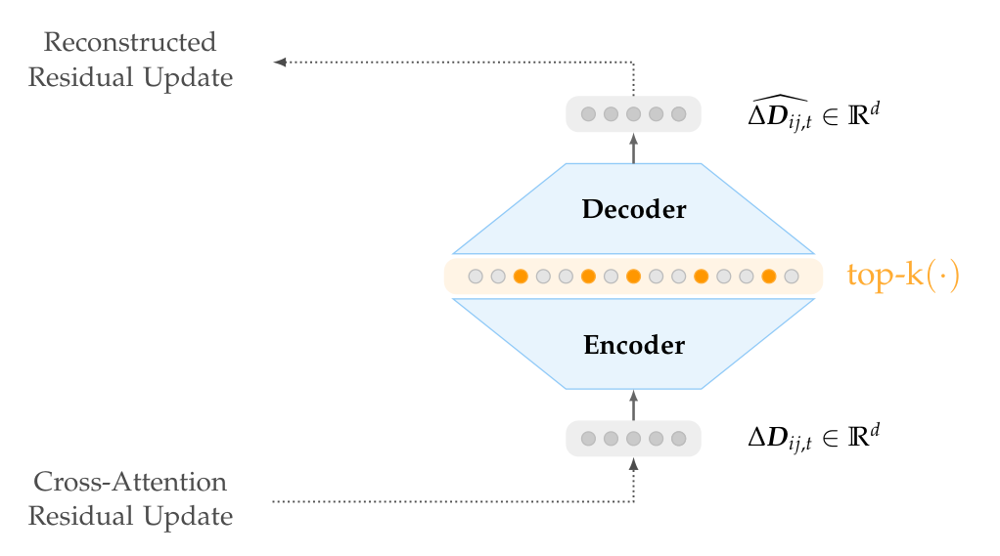{width=75% fig-align="center"}

A single SAE is shared across *all* spatial positions and *all* timesteps. This matters later: it means that a feature index refers to the same direction at $t=1.0$ and at $t=0.1$, which is what allows us to talk about a feature "persisting" through time.

## Training the Sparse Autoencoders

I generated activations from SD v2.1 for 50,000 prompts from LAION-COCO [@schuhmann2022laioncoco], using DDIM [@song2022ddim] with 25 steps and classifier-free guidance at scale 9, and recorded the conditional-pass residual updates of two blocks:

- **`down.2.0`**, in the encoder, previously identified as important for object and style knowledge [@basu2024mechanisticknowledgelocalizationtexttoimage];
- **`up.1.1`**, in the decoder, to see what the upsampling path does.

Every prompt yields a $16\times16\times1{,}280$ tensor per step. Treating every spatial location as a sample gives $3.2\times10^8$ training vectors per block. The SAEs use $n_f=5{,}120$ (a $4\times$ expansion), $k=10$, $k_{\text{aux}}=256$ with $\lambda=1/32$, unit-norm decoder columns, a geometric-median initialisation of $\boldsymbol{b}_{\text{pre}}$, and a learning rate taken from the scaling laws of @gao2024scalingevaluatingsparseautoencoders. Training runs over $2\times10^9$ activations.

| Block | Resolution | $R^2$ (%) ↑ | Dead (%) ↓ | LPIPS ↓ | Mean $\ell_1$ ↓ | Median $\ell_1$ ↓ |
|:------|:----------:|:-----------:|:----------:|:-------:|:----------:|:-----------:|
| `down.2.0` | 512 × 512 | 36.60 | 0.00 | 0.492 | 0.152 | 0.100 |
| `down.2.0` | 768 × 768 | 36.48 | 0.00 | 0.410 | 0.104 | 0.067 |
| `up.1.1`   | 512 × 512 | 39.43 | 0.00 | 0.444 | 0.136 | 0.085 |
| `up.1.1`   | 768 × 768 | 40.30 | 0.00 | 0.361 | 0.092 | 0.055 |

: SAE reconstruction quality. $R^2$ is measured on the residual update itself; LPIPS and the pixel-wise $\ell_1$ distances compare final images generated with and without replacing the update by its SAE reconstruction (1,000 prompts × 5 seeds). Both SAEs were trained on 512 × 512 data only. {.striped .hover}

An $R^2$ of roughly 37–40 % may not sound like much, but it is in line with prior SAEs on multi-step diffusion models at similar $n_f$ and $k$ [@shi2025dissectingmitigatingdiffusionbias; @tinaz2025emergenceevolutioninterpretableconcepts], and when the reconstruction is spliced back into the model the final images stay perceptually close to the originals. With only ten active features out of 5,120 per location, that is a strong compression. No features are dead.

The bottom rows of the table are the first surprise. **The SAEs were never shown a $768\times768$ generation**, yet reconstruction quality is the same, and the downstream image metrics are even a bit better. I will come back to this.

{width=45% fig-align="center"}

### How Feature Usage Evolves over Time

A first look at the dictionary through time already shows some structure.

::: {layout-ncol=2}
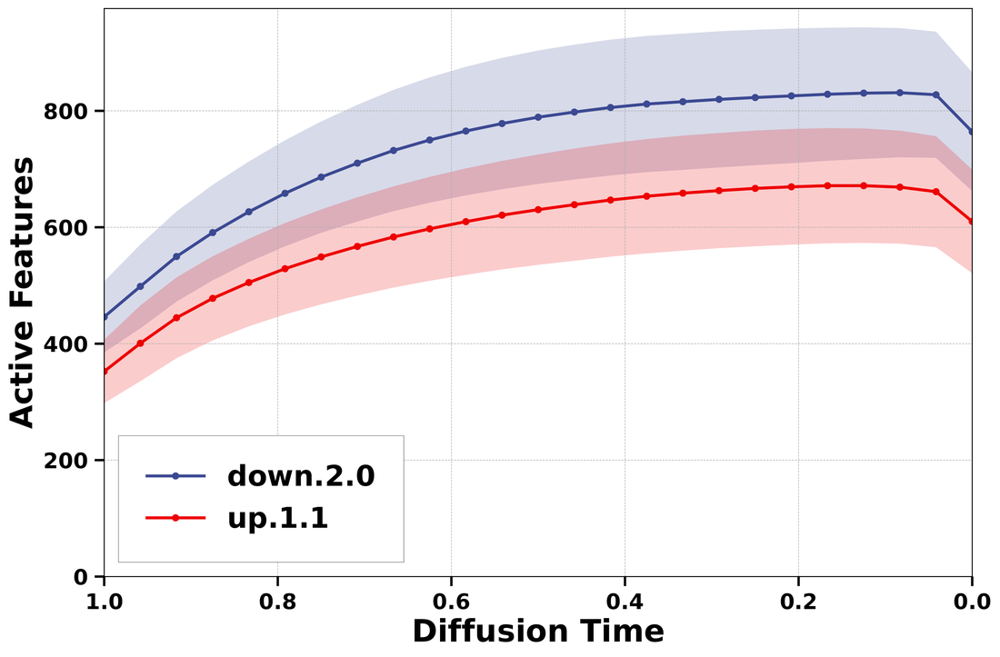

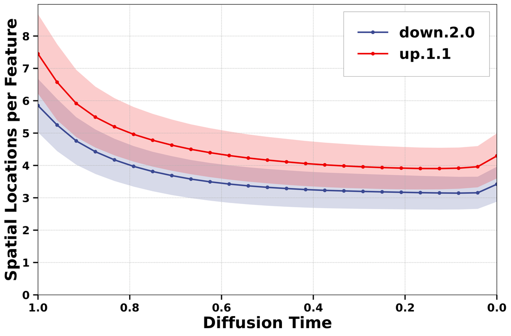
:::

Early on, in the high-noise regime ($t\in[0.6, 1.0]$), relatively few features are active, but each covers many spatial positions. These are broad, global concepts. As denoising goes on, many more features switch on, each confined to fewer positions, and the count drops again over the last couple of steps. `down.2.0` consistently uses more features and more localised ones than `up.1.1`, which fits the idea that the encoder block deals with objects and composition while the decoder block does more diffuse rendering work.

## What Do the Features Encode?

### Top-Activating Images

To give a feature a "meaning", I score each generation by the feature's spatially averaged activation, averaged again over all 25 timesteps:
$$
\bar{\mu}^\varphi(\boldsymbol{c}, \boldsymbol{z}_{1.0}) = \frac{1}{|\mathcal{T}|}\sum_{t\in\mathcal{T}} \frac{1}{hw}\sum_{i,j} S^{\varphi}_{ij,t}.
$$
I then show the nine highest-scoring images from a test set of 5,000 prompts × 5 seeds, with the activation map at the feature's peak time overlaid. (Taking the temporal *maximum* instead of the mean works worse, as it picks up transient spikes rather than consistent behaviour.)

A familiar taxonomy shows up, close to what others have found in SD models [@surkov2024unpackingsdxlturbointerpreting; @cywinski2025saeuron; @tinaz2025emergenceevolutioninterpretableconcepts]. Some features are clearly **objects**: 2165 fires on dog faces, 3094 on roses, 4255 on grassy fields. Others are **styles**: 810 on old group photographs, 1362 on painterly scenes, 2420 on anime. Many other features encode less nameable things such as textures or grid-like layouts.

### Steering the Generation

Top-activating images only show correlation. To test what a feature *does*, I add its decoder direction to the residual update at every spatial position. Because SD uses classifier-free guidance, the final noise prediction is
$$
\tilde{\boldsymbol{\epsilon}} = \boldsymbol{\epsilon}_\theta(\boldsymbol{x}_t, \varnothing) + \omega\,\big(\boldsymbol{\epsilon}_\theta(\boldsymbol{x}_t, \boldsymbol{c}) - \boldsymbol{\epsilon}_\theta(\boldsymbol{x}_t, \varnothing)\big),
$$
so whatever we add to the conditional pass gets amplified by $\omega$ *relative to* the unconditional pass. The most effective intervention turns out to be asymmetric: **add** the feature in the conditional pass and **subtract** it in the unconditional one,
$$
\boldsymbol{\Delta D}'_t =
\begin{cases}
\boldsymbol{\Delta D}_t + \xi\,(\boldsymbol{1}_{h,w}\otimes\boldsymbol{f}_\varphi) & \text{conditional pass},\\
\boldsymbol{\Delta D}_t - \xi\,(\boldsymbol{1}_{h,w}\otimes\boldsymbol{f}_\varphi) & \text{unconditional pass}.
\end{cases}
$$

::: {.callout-tip icon="false" collapse="true"}
## Why the asymmetric intervention?

The figure below transfers features from a "rose" prompt into a "dog" prompt in four ways: intervening only on the unconditional pass, only on the conditional pass, adding to both, or adding to the conditional pass while subtracting from the unconditional pass. Only intervening on the unconditional pass does almost nothing useful, and adding to both passes partially cancels out under guidance. The asymmetric version (bottom row) gives the cleanest roses, consistent with what @surkov2024unpackingsdxlturbointerpreting found for SDXL.

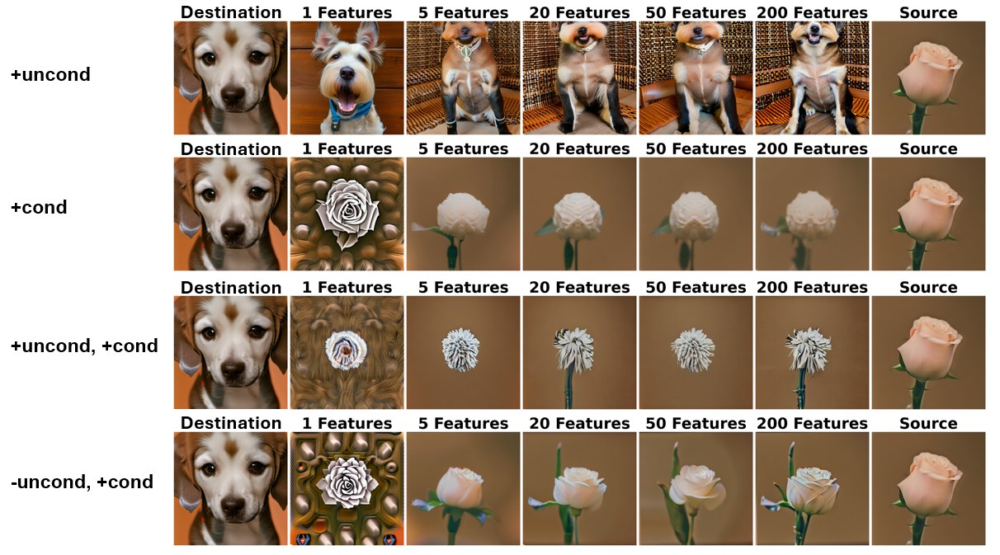
:::

Here is the result of amplifying each of the six features above on the Roman emperor prompt, with strength $\xi$ increasing from left to right:

{width=80% fig-align="center"}

The interventions match the top-activating images remarkably well. The **object features replace the subject**: the emperor becomes a dog, a rose, or a grass field. The **style features keep the subject but change the aesthetic**: an old photograph, a medieval painting, an anime drawing. The same experiments on `up.1.1` produce only subtle textural changes, which is again in line with the decoder block's more diffuse feature usage.

## A Temporal Hierarchy

So far every intervention was applied across all 25 steps. The more interesting question is *when* a feature matters. I split the trajectory into three windows, early ($t\in[0.6,1.0]$), mid ($t\in[0.2,0.6]$) and late ($t\in[0.0,0.2]$), and apply the same interventions only within one window.

::: {.panel-tabset}
## Early ($t\in[0.6,1.0]$)

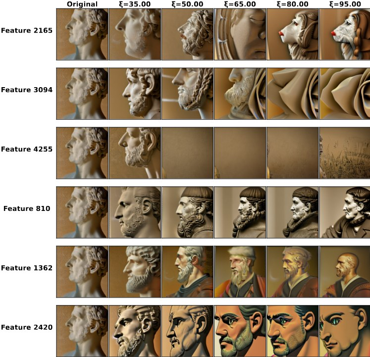{width=80% fig-align="center"}

Early interventions are almost as powerful as intervening throughout. The dog feature replaces the emperor with a dog; style features turn the whole image into an old photograph, a medieval painting, or an anime drawing. **Both composition and global style are decided here.** (Feature 4255 is the exception: early intervention alone is not quite enough to turn the emperor into grass.)

## Mid ($t\in[0.2,0.6]$)

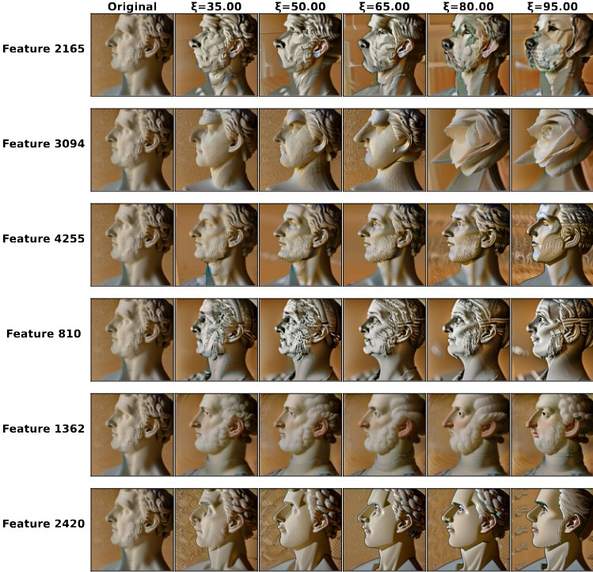{width=80% fig-align="center"}

By the middle stage the layout is mostly in place. Instead of replacing the subject, features now **blend** with it: the dog feature produces an emperor with canine features rather than a dog. Style features modify the existing image rather than setting its aesthetic.

## Late ($t\in[0.0,0.2]$)

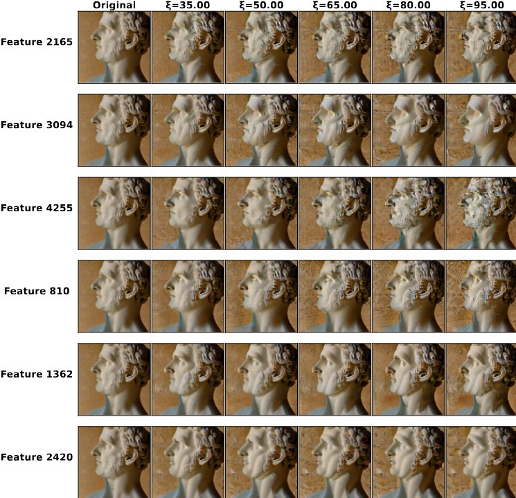{width=80% fig-align="center"}

At the end, the image is essentially fixed. The same interventions only produce **minor textural changes** and small artefacts; the portrait itself stays the same.
:::

To check that this is not cherry-picked, I ran a "knockout" experiment that removes the *entire* reconstructed feature contribution within a window (subtracting it in the conditional pass and adding it in the unconditional pass), over 1,000 prompts and 5 seeds:

| Block | Window | LPIPS | Mean $\ell_1$ | Median $\ell_1$ |
|:------|:-------|:-----:|:----:|:------:|
| `down.2.0` | Early | **0.580** | **0.187** | **0.131** |
| `down.2.0` | Mid   | 0.272 | 0.079 | 0.044 |
| `down.2.0` | Late  | 0.105 | 0.038 | 0.022 |
| `up.1.1`   | Early | **0.554** | **0.171** | **0.116** |
| `up.1.1`   | Mid   | 0.288 | 0.082 | 0.046 |
| `up.1.1`   | Late  | 0.101 | 0.039 | 0.022 |

: Image-level change caused by knocking out all active SAE features within a window. Higher means the window matters more. {.striped .hover}

The effect drops by roughly a factor of two from early to mid and again from mid to late, in both blocks. This matches the frequency-based view of diffusion models as building images coarse-to-fine, low frequencies first [@dieleman2024spectral]. One finding differs from @tinaz2025emergenceevolutioninterpretableconcepts, who place stylistic control mainly in the middle stage of SD v1.4. In my experiments, **global style is already set early**. I suspect the difference comes mostly from the intervention: they add features with equal strength to both guidance passes, which, as the callout above shows, weakens a feature's visual effect considerably.

### Cross-Resolution Generalisation

Recall that the SAEs were trained only on $512\times512$ generations. SD v2.1 can also generate at $768\times768$, which gives a latent with more spatial positions and a somewhat different activation distribution. The reconstruction metrics already showed that the dictionary still fits. The interventions transfer as well:

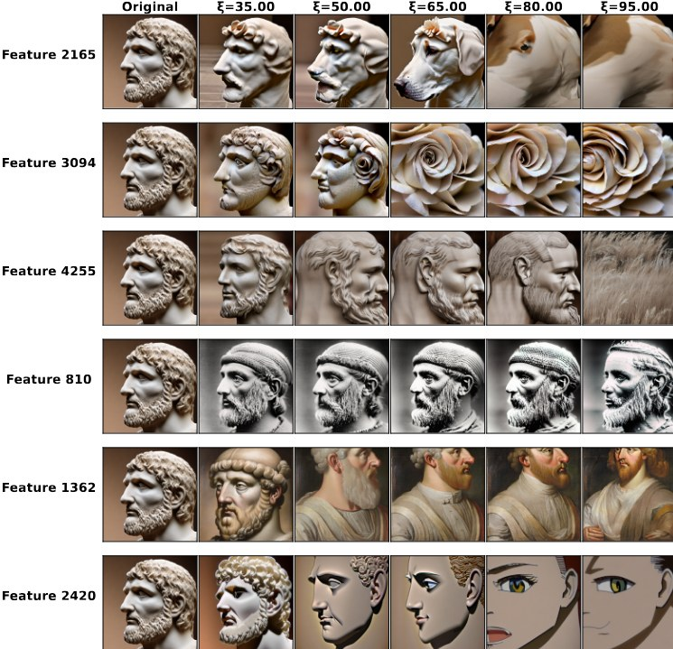{width=80% fig-align="center"}

Dogs, roses, photographs and anime emperors appear just as before. This suggests that the SAE has learned compositional concepts that are close to resolution-invariant, and it has a practical consequence: **SAEs for diffusion models can be trained on cheaper, low-resolution data** and then used on high-resolution generations. Together with the finding of @surkov2024unpackingsdxlturbointerpreting that SAEs transfer from a distilled one-step model to its multi-step parent, it hints that SAE features are more robust to distribution shift than one might fear.

## From Features to Feature Sets: Activation Patching

Single features are one thing, but concepts in a real generation are spread over many of them. To move a whole concept from one prompt to another, I adapt the activation patching approach of @surkov2024unpackingsdxlturbointerpreting to multi-step models with guidance.

Given a source prompt $\boldsymbol{c}_{\text{src}}$ (say, "cat") and a destination prompt $\boldsymbol{c}_{\text{dest}}$ (say, "bird"), I compute a differential score for each feature from its normalised mean activation,
$$
\gamma_\varphi = \frac{\bar{\mu}_\varphi(\boldsymbol{c}_{\text{src}})}{\sum_{\varphi'}\bar{\mu}_{\varphi'}(\boldsymbol{c}_{\text{src}})} - \frac{\bar{\mu}_\varphi(\boldsymbol{c}_{\text{dest}})}{\sum_{\varphi'}\bar{\mu}_{\varphi'}(\boldsymbol{c}_{\text{dest}})},
$$
and take the top-$m$ features as the source set $\mathcal{K}_{\text{src}}$ and the bottom-$m$ as the destination set $\mathcal{K}_{\text{dest}}$. With a patch $\boldsymbol{P}_t(\boldsymbol{c},\mathcal{K}) = \sum_{\varphi\in\mathcal{K}} \boldsymbol{S}^\varphi_t(\boldsymbol{c})\otimes\boldsymbol{f}_\varphi$, the destination generation is modified as
$$
\boldsymbol{\Delta D}'_t = \boldsymbol{\Delta D}_t(\boldsymbol{c}_{\text{dest}}) \mp \alpha\,\boldsymbol{P}_t(\boldsymbol{c}_{\text{dest}},\mathcal{K}_{\text{dest}}) \pm \beta\,\boldsymbol{P}_t(\boldsymbol{c}_{\text{src}},\mathcal{K}_{\text{src}}),
$$
with the upper signs for the conditional and the lower signs for the unconditional pass, and $\alpha=1$, $\beta=2$. In words: remove what is characteristic of the destination concept, then add what is characteristic of the source concept, each with its **full spatial activation map**.

{width=80% fig-align="center"}

Concepts transfer reliably with as few as **5 to 20 features**. That is far fewer than the spatially masked approach of @surkov2024unpackingsdxlturbointerpreting usually needs. My guess is that this is because I keep each feature's native spatial structure, whereas their method collapses the activation within a semantic mask to a single value and broadcasts it. The same works for `up.1.1` (which needs somewhat more features) and, again, at $768\times768$.

Stratifying the patching by time confirms the hierarchy from before, now for whole feature sets:

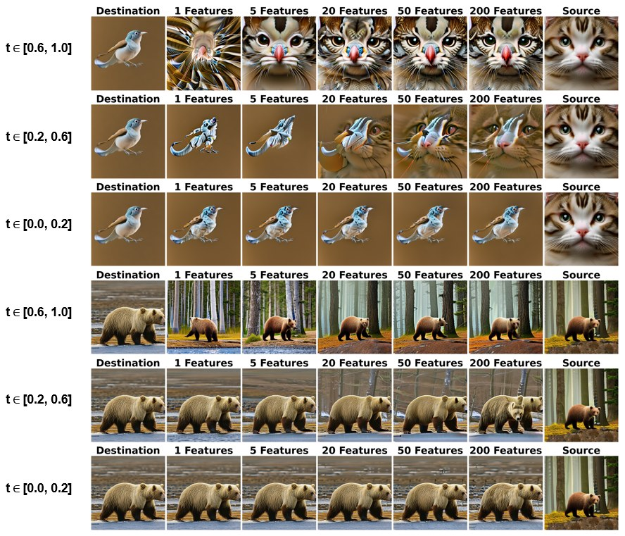{width=80% fig-align="center"}

Early patching rewrites the subject and the background. Mid-stage patching produces hybrids. Late patching does essentially nothing, since the model has already committed.

## Temporal Circuit Discovery

Activation patching tells us *which* features carry a concept, but not *how* they interact. In language models, the tool for this is **sparse feature circuits** [@marks2025sparsefeaturecircuitsdiscovering]: a graph whose nodes are SAE features and whose edges quantify how much one feature causally drives another. The new ingredient for diffusion is time. The U-Net is applied recurrently, so a feature at step $\tau_i$ can affect the latent and therefore every feature at later steps.

### Circuits as Temporal DAGs

I define a temporal sparse feature circuit as a weighted DAG $\mathcal{C}=(\mathcal{V},\mathcal{E},W)$ over the discrete timesteps $\mathcal{T}=\{\tau_1=1.0,\ldots,\tau_T\}$:

- **Nodes** $v = (\kappa,\tau_i)$, where $\kappa$ is either an SAE feature index or the special symbol `res` for the SAE **error term**;
- **Edges** $(v_i, v_j)$ only go forward in generation time, $\tau_i > \tau_j$;
- **Weights** $W(v_i,v_j)\in\mathbb{R}$ measure the strength and sign of the causal influence.

The error node is important. The SAE reconstruction is imperfect, and @marks2025sparsefeaturecircuitsdiscovering show that the residual $\boldsymbol{e}_t = \boldsymbol{\Delta D}_t - \widehat{\boldsymbol{\Delta D}}_t$ often carries causally essential information. So instead of treating the SAE as an approximation, I write the update *exactly* as
$$
\boldsymbol{\Delta D}_t = \sum_{\varphi=1}^{n_f} \boldsymbol{S}^\varphi_t\otimes\boldsymbol{f}_\varphi + \boldsymbol{b}_{\text{pre}} + \boldsymbol{e}_t,
$$
and keep the error as a node in the graph.

### Indirect Effects in a Recurrent Model

The importance of a node is its *indirect effect* [@pearl2001direct]: how much a downstream metric $\mathcal{M}$ changes when we set the node's activation to what it would have been under a counterfactual prompt,
$$
\operatorname{IE}(\mathcal{M}; \boldsymbol{a}_v) = \mathcal{M}\big(\boldsymbol{c}_{\text{dest}} \mid do(\boldsymbol{a}_v = \boldsymbol{a}_v^{\text{src}})\big) - \mathcal{M}(\boldsymbol{c}_{\text{dest}}).
$$
Here $\boldsymbol{a}_v\in\mathbb{R}^{2\times h\times w}$ stacks the node's spatial activation maps for the unconditional and conditional passes. The effect is "indirect" because it is mediated by everything the model computes afterwards, including every later denoising step.

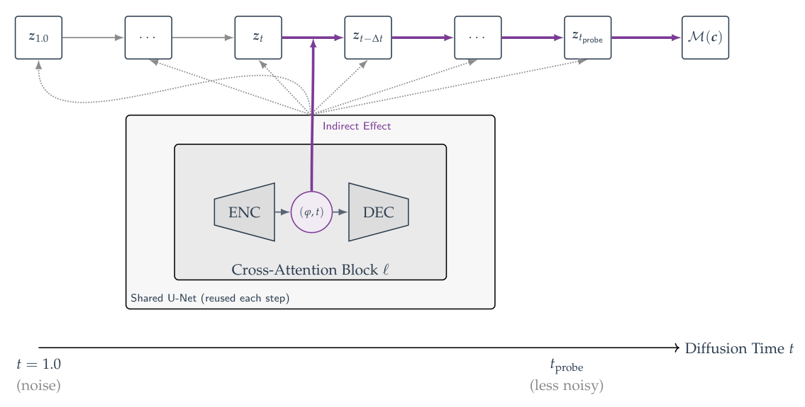{width=85% fig-align="center"}

Computing this exactly would take one forward pass per feature per timestep, which is far too expensive. Attribution patching [@nanda2022attribution; @kramar2024atp] replaces it by a first-order Taylor expansion, $\widehat{\operatorname{IE}} = \langle \nabla_{\boldsymbol{a}_v}\mathcal{M},\, \boldsymbol{a}_v^{\text{src}} - \boldsymbol{a}_v^{\text{dest}}\rangle_F$, which needs only two forward passes and one backward pass for *all* nodes. Since the linear approximation is known to underestimate effects far upstream, and long-range temporal effects are exactly what I am after, I use **integrated gradients** [@sundararajan2017axiomaticattributiondeepnetworks] with $N=10$ interpolation steps instead:
$$
\widehat{\operatorname{IE}}_{\text{ig}} = \left\langle \frac{1}{N}\sum_{i=0}^{N-1} \nabla_{\boldsymbol{a}_v}\mathcal{M}\Big|_{\boldsymbol{a}_v = \frac{i}{N}\boldsymbol{a}_v^{\text{dest}} + (1-\frac{i}{N})\boldsymbol{a}_v^{\text{src}}},\; \boldsymbol{a}_v^{\text{src}} - \boldsymbol{a}_v^{\text{dest}} \right\rangle_F .
$$

For edges I make a Markov assumption and only connect consecutive timesteps $(\tau_i,\tau_{i+1})$. The edge weight is then
$$
W(v_i, v_j) = \left\langle \boldsymbol{g}_{v_j},\, \frac{\partial \boldsymbol{a}_{v_j}}{\partial \boldsymbol{a}_{v_i}}\boldsymbol{\delta}_{v_i} \right\rangle_F = \left\langle \Big(\frac{\partial \boldsymbol{a}_{v_j}}{\partial \boldsymbol{a}_{v_i}}\Big)^{\!\top}\boldsymbol{g}_{v_j},\, \boldsymbol{\delta}_{v_i} \right\rangle_F,
$$
where $\boldsymbol{g}_{v_j}$ is the (integrated) gradient of the metric with respect to the later node and $\boldsymbol{\delta}_{v_i}$ the activation difference of the earlier node. Written in the second form, it is a single vector-Jacobian product per downstream node, which gives the edges into $v_j$ from all upstream nodes at once.

### A Probe as the Metric

Gradient-based attribution needs a differentiable scalar metric. In language models this is usually a logit difference between two candidate next tokens. Diffusion models have no output vocabulary, so I built one: a **diagnostic probe**, a small CNN trained to classify the concept of interest ("cat" vs. "bird") from the output of the cross-attention block at a chosen timestep $t_{\text{probe}}$. Its raw logit,
$$
\mathcal{M}(\boldsymbol{c}) = \log\mathbb{P}(\text{src}\mid\boldsymbol{D}^{\text{out}}_{t_\text{probe}}) - \log\mathbb{P}(\text{dest}\mid\boldsymbol{D}^{\text{out}}_{t_\text{probe}}),
$$
measures how strongly the model's internal state represents one concept over the other. A useful side effect: the backward pass stops at $t_{\text{probe}}$, so there is no need to backpropagate through the rest of the sampling trajectory.

## Anatomy of a "Cat vs. Bird" Circuit

To test the framework, I picked a simple comparative task. On 50 template prompt pairs such as *"A photorealistic image of a black and white [cat / bird] facing the camera"*, each with two seeds, I computed node and edge effects in `down.2.0` over the first five steps ($t\in[0.8, 1.0]$), where we now know composition is decided. Attribution is computed in both directions (cat → bird and bird → cat) to pick up features whose removal breaks a concept *and* whose insertion creates it.

One practical detail turned out to matter. Effect magnitudes vary by orders of magnitude between timesteps:

::: {layout-ncol=2}
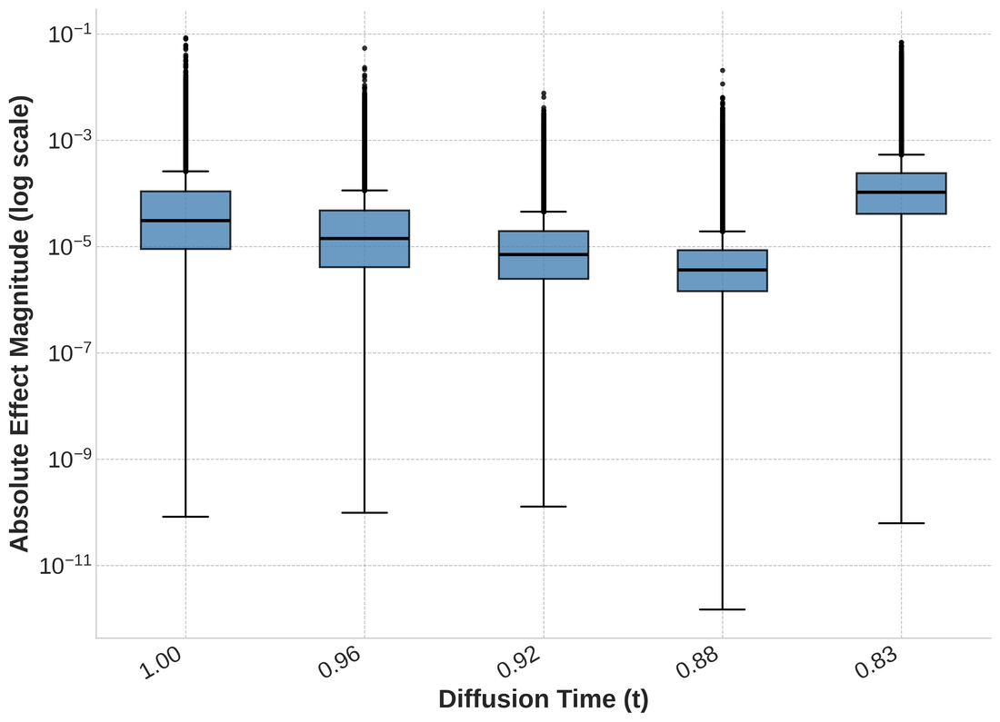

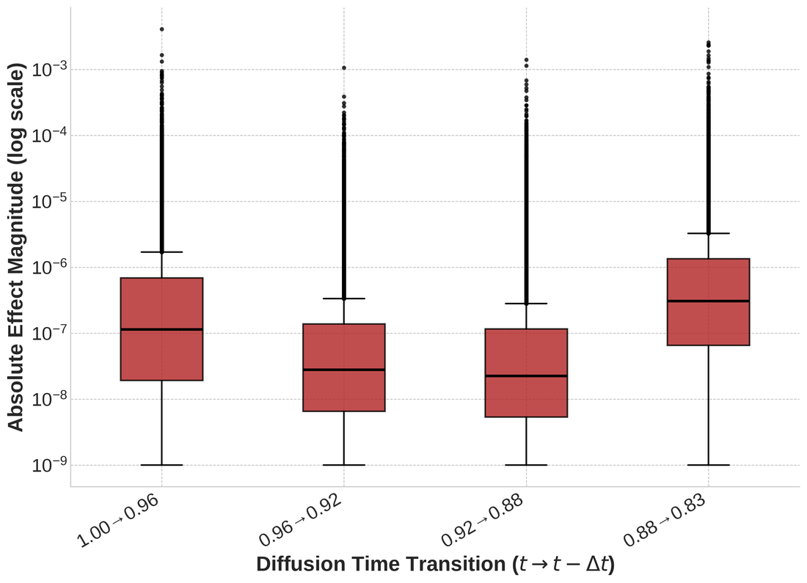
:::

A single global threshold, as used by @marks2025sparsefeaturecircuitsdiscovering, would keep almost everything from a couple of high-magnitude steps and nothing from the rest, leaving gaps in the chain. Instead, I keep the **top-7 nodes and top-5 edges per timestep**, which makes sure every step of the Markov chain is represented.

![The "cat vs. bird" circuit in `down.2.0` for $t\in[0.8, 1.0]$. Circles are SAE features, diamonds the SAE error term. Node colour shows the indirect effect on the probe (red ≈ towards "bird", blue ≈ towards "cat"); edge colour and thickness show sign and strength of the causal influence.](img/circuit_cat_bird.png)

A few things stand out:

- **Temporal persistence.** Features such as F380, F1761, F2093 and F4451 show up at several consecutive steps. Their effect changes over time, though, in intensity and sometimes even in sign, so a feature's role is not fixed across the trajectory.
- **Few self-edges.** Somewhat surprisingly, a feature rarely drives *itself* at the next step. Information is handed between different features instead.
- **The error term is a highway.** The `Res` node is among the top seven at *every* step, and many strong edges run through it. Part of the computation is clearly not captured by a 5,120-feature, $k=10$ dictionary.

What are the persistent features? Their top-activating images and steering effects tell a consistent story:

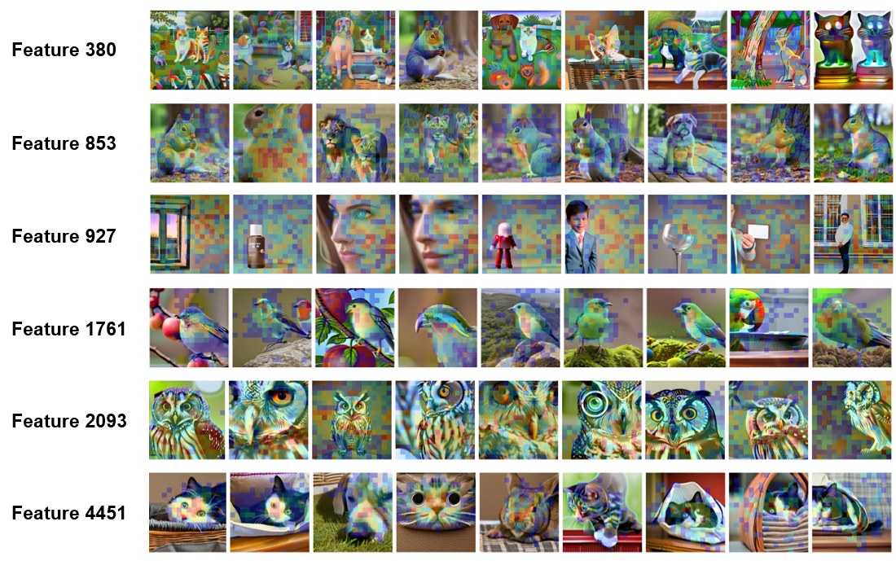

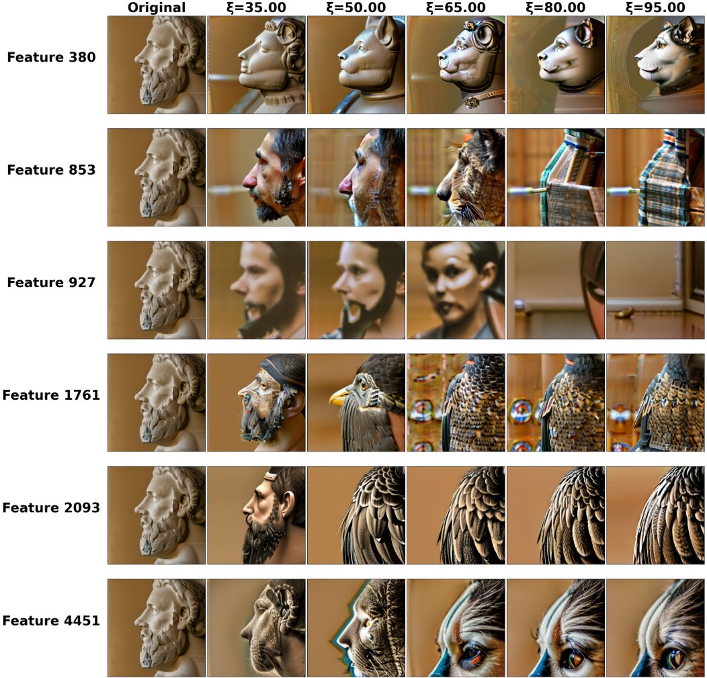{width=80% fig-align="center"}

Feature 1761 is about small birds, 2093 about owls, and 4451 about domestic cats; 853 responds to lions, squirrels and dogs, and 380 to dogs, squirrels and cats. Amplifying them turns the king into the matching bird- or mammal-like figure. Feature 927 is the odd one out: its top examples are human faces and glass, and steering with it gives abstract results, so I excluded it from the circuit.

### Swapping the Circuit

As a final test of whether these nodes really control the concept, I use them for **bidirectional activation patching**: in the bird prompt, remove the bird features and insert the cat features, and vice versa.

::: {layout-ncol=2}
![(a) "A close-up image of a brown [concept] in profile."](img/bidirect1.jpg)

![(b) "An artistic image of a grey [concept] sitting still."](img/bidirect2.jpg)

![(c) "A highly detailed image of a white [concept] facing the camera."](img/bidirect3.jpg)

![(d) "A highly detailed image of a brown [concept] sitting still."](img/bidirect4.jpg)
:::

On randomly drawn test prompts, swapping only the circuit features reliably turns cats into birds and birds into cats, while keeping colour, pose and setting. This is qualitative evidence that the circuit has found the components that causally control the concept, and not just features that happen to correlate with it.

## Reflections

The clearest result of the thesis is the **temporal hierarchy**. Using a single SAE shared across all timesteps, the same story shows up for single features, for feature sets, and for whole-dictionary knockouts: diffusion decides *what* and *in which style* during the first few steps, *refines and blends* in the middle, and only *polishes texture* at the end. If you want to steer, edit, or unlearn something in a diffusion model, the early steps are where the leverage is.

The **cross-resolution transfer** was more of a surprise, and a convenient one. If SAE features are this robust to resolution, and, as other work suggests, to distillation, then most of the expensive dictionary learning could be done on cheap data. Crosscoders [@lindsey2024sparsecrosscoder] and universal SAEs [@thasarathan2025universalsparseautoencodersinterpretable] seem like the right tools to push this further, for example to compare a base model with its LoRA fine-tunes [@hu2021loralowrankadaptationlarge] or SD v1.4 with SDXL.

The **circuit discovery** part is the most exploratory, and it has real limitations:

- It was shown on one simple contrast (cat vs. bird), over five timesteps, and evaluated qualitatively.
- It looks at a single cross-attention block. Other blocks can compensate for ablated computation, which makes standard faithfulness and completeness metrics hard to interpret in this setting.
- The large role of the error term probably reflects the modest SAE size ($n_f=5{,}120$, $k=10$). A wider, less sparse dictionary should shrink it, although @marks2025sparsefeaturecircuitsdiscovering also find that removing error nodes is disruptive in LLM circuits.
- The integrated-gradient estimates sum over the conditional and unconditional passes. How guidance interacts with these estimates deserves its own study.

Still, I think the framework is a useful first step: it turns "this feature matters" into "this feature at step $\tau_i$ drives that feature at step $\tau_{i+1}$, which pushes the model towards *bird*", and the bidirectional patching gives a way to check it. Natural next steps are circuits across several blocks, spatially masked circuits, and harder targets than cats and birds, for example datasets designed to surface social biases, where knowing *where and when* a model makes a decision would be directly useful.

If you want to dig into the details, the code is on [<i class="bi bi-github"></i> GitHub](https://github.com/JHSchlegel/mechinterp-diffusion) and the full thesis is linked on my [research page](../../research.qmd).
